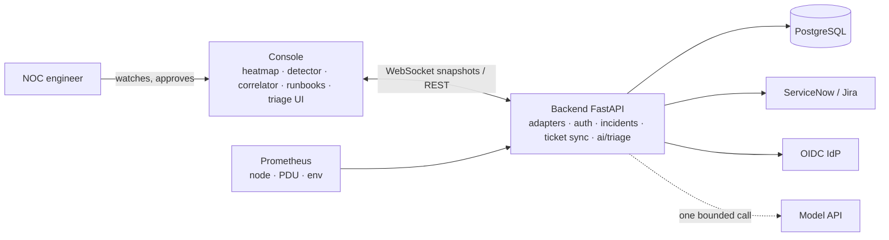

# DC-North AIOps

**A spec-driven, agentic-AI-built operations console for a data-centre hall: one correlated incident instead of 24 alarms, a probable cause with confidence, and a runbook the operator approves in one tap. Extended with a bounded AI triage feature (the model proposes; the application saves), evaluated with a golden set, and deployable with backup-and-restore proof.**

Final project for *Agentic AI Coding: From Specification to Deployment* (Prof. Deepak N. Subramani, CDS / QUEST Lab, IISc Bengaluru; CCE Sept–Oct 2026 cohort).

| | |
|---|---|
| Deployed console (Project submission URL) | https://vaidkamal.github.io/Agentic-AI-Coding-dc-aiops/frontend/ |
| Session transcript | https://vaidkamal.github.io/Agentic-AI-Coding-dc-aiops/transcripts/dc-aiops_session_log.html |
| Design decision walkthrough and interview preparation | https://vaidkamal.github.io/Agentic-AI-Coding-dc-aiops/docs/dc-aiops-design-walkthrough.html |
| Architecture (C4, request paths, failure table) | https://vaidkamal.github.io/Agentic-AI-Coding-dc-aiops/dc-aiops-architecture.html |
| Source code | https://github.com/vaidkamal/Agentic-AI-Coding-dc-aiops |

## 1. The problem

Hall 2 has 4 zones, 24 racks, 1,200 kW of design power. Operators watch inlet temperature, CPU, PDU power and host availability on separate screens. When a CRAC unit degrades, all six racks in its zone alarm at once; root cause takes hours because nobody correlates the alarms, and the "fix" is a page to facilities after the damage is done.

## 2. What was built

**Console** (`frontend/index.html`, one self-contained file)
- Rack-floor heatmap, site load and PUE, KPIs, per-rack time series.
- Anomaly detection: rolling z-score (window 20) per metric plus absolute ceilings (27 °C per ASHRAE A1, 92 % CPU).
- Zone correlation: three or more racks rising together → **one** CRAC incident; per-rack alarms suppressed.
- Incidents carry probable cause, evidence and a confidence number; runbooks execute only after an explicit **Approve**; every step is logged with the actor; auto-resolve after five normal samples.
- Capacity forecast (least-squares regression → days to the 80 % planning line), rule-based copilot, three injectable faults for verification.
- **Triage tab**: type what you see ("C-01, C-03 and C-05 all at 29 °C since 14:10, CRAC-3 alarm") → structured draft → review, edit, confirm → incident.

**Backend** (`backend/`, FastAPI)
- Telemetry adapters (simulator, Prometheus with overridable PromQL) broadcasting one fixed snapshot shape over WebSocket.
- OIDC bearer auth (JWKS), incident API with timeline, ServiceNow / Jira ticket sync with work notes.
- `ai/`: one Anthropic call with a declared response model, post-validation and rack-id normalisation, 20 s timeout, 1,024-token cap, no retries, per-user rate limit, monthly budget reserve/settle, OpenTelemetry → Phoenix tracing with redaction. **No import path from `ai/` to anything that writes**; a test guards it.

**Evaluation** (`evals/`): golden set T1–T8 chosen by dimension (zone vs rack, typo ids, vague, Hinglish correction, pasted log, below threshold, prompt injection); deterministic checks with pass / fail / unable_to_assess / budget_blocked; judge rubric for the two semantic criteria; codebook v1; mocked baseline (live run asks for budget approval).

**Deployment** (`deploy/`, `.github/workflows/`): CI on every push; deploy on main via GitHub OIDC → ECR → one-off migration task → ECS Fargate → smoke test; Terraform for VPC, ALB, ECS, RDS, ECR, Secrets Manager, CloudFront; `backup.sh` → `destroy.sh` (aborts if the snapshot fails) → `restore.sh` (greps the API for a known `INC-nnn`); Cloudflare Quick Tunnel script for a temporary public demo.

## 3. How it was built: the course method, weekend by weekend

| Weekend | Method | Artefact in this repo |
|---|---|---|
| 1 · Agents | Agent loop, harness, blast radius sets oversight, stop caps | Principles in `CLAUDE.md` (approval gate, bounded calls) |
| 2 · SDD | Spec → Plan → Implement → Verify → Iterate; four control surfaces; "a criterion is a sentence with a command attached"; test the test | `CLAUDE.md`, `.claude/settings.json`, `scripts/verify.sh`, `docs/test-the-test.md` |
| 3 · Specs | `goal` · `frontend` · `backend` · `api-contract`; implementation plan with evidence of completion; fifth spec `AI-spec.md`; minimal viable agent | `specs/`, `specs_with_AI_feature/` |
| 4 · Test & deploy | AC → check mapping; CI; phases 4–7; backup before destroy; restore proof | `backend/tests/`, `.github/workflows/`, `deploy/` |
| 5 · Evals | Observability spec + runbook; test prompts by dimension; open/axial coding → codebook; evaluators; golden set; judge calibration | `specs_with_AI_Evals/`, `evals/` |
| 6 · Design | C4; one complete request; testable failure table; does-it-need-AI / workflow-or-agent flowcharts; ADRs; "keep ownership" | `dc-aiops-architecture.html`, `docs/design-decisions.md`, `docs/interview-questions.md` |

The three `specs*` folders are snapshots, as in the course reference project: the four specs, then the four plus the AI spec with revision-2 sections, then everything plus observability and evaluation.

## 4. Repository map

```
CLAUDE.md                     instructions the coding agent reads every session
.claude/settings.json         agent may run verify/pytest; may not edit specs or the checks
specs/                        goal · frontend · backend · api-contract · implementation-plan (phases 0–9)
specs_with_AI_feature/        + AI-spec.md; revision-2 sections appended to the four specs
specs_with_AI_Evals/          + observability-spec · observability-runbook · ai-implementation-plan
backend/                      app.py · auth.py · adapters/ · integrations/ · ai/ · tests/ (73 tests)
frontend/index.html           the console
evals/                        golden/cases.json · run_cases.py · codebook.md · judge_rubric.md · review-table.md · baseline.md
scripts/verify.sh             definition of done
deploy/                       terraform/ · scripts/ · deployment-brief.md · runbook-release.md · production-rollout.md
.github/workflows/            ci.yml · deploy.yml
docs/                         architecture.md · design-decisions.md (12 ADRs) · interview-questions.md · OPEN-QUESTIONS.md · test-the-test.md
transcripts/                  session log + link to the raw session
dc-aiops-architecture.html    architecture page (GitHub Pages)
index.html                    GitHub Pages landing page
```

## 5. Architecture

Full version with diagrams: [`docs/architecture.md`](docs/architecture.md) (Markdown, renders on GitHub) and the [HTML page](https://vaidkamal.github.io/Agentic-AI-Coding-dc-aiops/dc-aiops-architecture.html). Decisions: [`docs/design-decisions.md`](docs/design-decisions.md).



| Layer | Responsibility | Owns |
|---|---|---|
| Console (`frontend/index.html`) | Floor heatmap, z-score detection, zone correlation, runbook catalogue, triage draft review | Detection logic, the Approve button |
| Backend (`backend/`) | Telemetry adapters → one snapshot shape; OIDC; incident API with timeline; ticket sync; `/ai/triage` with rate limit, budget, tracing | Every write and every model call |
| Database | Incidents, events, runbook runs, AI spend (in-memory in the POC, PostgreSQL in production) | The incident record |
| Prometheus | Telemetry history | — |

Two request paths matter. **Telemetry → runbook:** adapter → broadcast → detect → correlate (≥ 3 hot racks in a zone = one CRAC incident) → `POST /incidents` → operator approves → steps page people and tools → auto-resolve after 5 normal samples. **Free-text triage → incident:** `POST /ai/triage` returns a draft and no permission to write → operator edits and confirms → `POST /incidents` with the exact reviewed fields; the model is not called at that step and a test proves the AI module cannot reach the write path.

Authority: any authenticated operator may open, note and resolve; approving a runbook is logged with the actor (role restriction planned for production); nobody — human or model — can actuate cooling or power, because no such endpoint exists.

## 6. Run it

```bash
cp .env.example .env            # simulator, dev auth, no ticketing, no AI key needed for the console
docker compose up --build       # http://localhost:8080
./scripts/verify.sh             # ruff · 73 tests · evals --mock · no-write-path grep · CDN hosts → GREEN
```
Try it: Inject fault → "CRAC unit failure (Zone C)" → Incidents tab shows one incident → Approve runbook → watch it resolve. Then open Triage and type a symptom.

AI triage needs `ANTHROPIC_API_KEY`; evals: `python evals/run_cases.py --mock` (free) or `--live` (asks for budget approval first). Observability: `pip install arize-phoenix && phoenix serve`, set `PHOENIX_COLLECTOR_ENDPOINT`.

Deployment: `deploy/deployment-brief.md` (services, permissions, cost drivers, what survives teardown) and `deploy/runbook-release.md`.

Taking it to a real hall: `deploy/production-rollout.md` (readiness assessment, what the DC must provide, configuration, on-prem and AWS profiles, five-phase rollout with exit criteria, go-live checklist).

## 7. Verification evidence

| Requirement | Check | Result |
|---|---|---|
| Goal-spec success criterion | Inject CRAC failure; walk the journey | One Zone C incident, 91 % confidence, resolved after 5 normal samples |
| API contract | `pytest tests/test_api.py` | 9 passed (201/409/404/409-on-resolved/401, enums → 422, deprecated alias) |
| AI-1…AI-8 | `pytest tests/test_ai_triage.py` (frozen fixtures) | 33 passed; write-path mutation turns it red |
| OBS-1…OBS-3 | `pytest tests/test_tracing.py` | 10 passed |
| Golden set T1–T8 | `python evals/run_cases.py --mock` | 0 failures / 8 assessed (mocked) |
| Test the test | three deliberate faults | each went red, then green on restore |
| Deployment scaffold | `bash -n`, YAML parse, `tofu fmt`, HCL reference check | clean; `terraform validate` and apply pending an AWS account |

## 8. What I learned

1. **The spec is the contract, and it must be a file.** My first package shipped with the spec living inside a tab of the app. The next engineer could not open it. Nothing was "spec-driven" until `specs/` existed.
2. **A criterion is a sentence with a command attached.** "Works on mobile" is a hope; "no horizontal scroll at 360 px" and `pytest -k bounds` are criteria. Every acceptance criterion in `AI-spec.md` names its command.
3. **Fix the spec first.** The builders found eleven places where the documents and the code disagreed (base path, `kind: "other"` versus the null-field invariant, where budget is stored, six spans versus five plus one). Each got a decision, the affected documents were updated, and only then the code. The list is in `docs/OPEN-QUESTIONS.md`.
4. **Authority lives outside the model.** The triage model returns a proposal and no permission to write. The single write endpoint is called only after the operator confirms the exact fields. A test asserts the AI module cannot reach it; I broke it on purpose to see the test go red.
5. **The minimal viable agent is usually not an agent.** The two Weekend 6 flowcharts led to one model call with structured output. The condition for adding a tool is written in the ADR, so the decision can be revisited with evidence rather than enthusiasm.
6. **Test the test.** Three deliberate faults, each turned a check red. A green suite is only evidence once you know it can fail.
7. **Evaluation is a habit, not a score.** Eight cases reveal failure kinds; they do not estimate production frequency. Mocked checks protect logic in CI; live runs with budget approval test behaviour; the judge is a tool to apply the expert's rule at scale, not a replacement for it.
8. **A "done" label needs evidence.** Phase 7 (restore proof) is marked *blocked* in the plan because incidents are in-memory today. Saying so is worth more than a green row.
9. **Commit after every turn.** The cloud workspace was recycled between sessions and the code had to be recreated from the session record. Git is the memory the harness does not have.
10. **Keep ownership.** I can explain the request path, who may change data, what happens when the provider is slow or wrong, and why each choice was made. That, not the line count, is what the agentic workflow delivers.

## 9. What remains

Everything above this line has evidence; everything below has a plan and a named blocker.

| # | Work | Why it is open | Blocker | How to finish | Evidence of completion |
|---|---|---|---|---|---|
| 1 | **T16 — persist incidents to PostgreSQL** | The backend keeps incidents in a Python dict; a restart loses them and the ticket is the only durable copy. backend-spec requires PostgreSQL. Until then Phase 7 (backup → destroy → rebuild → same `INC-nnn` returns) cannot be proven, so the plan marks it *blocked*, not *done*. | Code only | Add SQLAlchemy + Alembic; tables `incidents`, `incident_events`, `runbook_runs`, `ai_spend`; `DATABASE_URL` from env (SQLite local, RDS cloud); replace the dict with repository functions; API contract unchanged; add a restart test. | `docker compose down && up` → `GET /api/v1/incidents` still returns the incident; contract tests stay green. |
| 2 | **Phase 9.6b — live evaluation** | T1–T8 have only run in mock mode, which proves the checking logic, not the model's behaviour. | `ANTHROPIC_API_KEY` (≈ US$0.06 for 8 calls) | `phoenix serve`; set `PHOENIX_COLLECTOR_ENDPOINT`; `python evals/run_cases.py --live` (asks for `y`); then runbook §C–H: one Phoenix note per observation (open coding), group into the codebook (axial coding), one hill-climb round on the prompt's rules section, model/effort comparison, keep the cheapest config that still passes. | `evals/baseline.md` replaced by live results with Phoenix links; `ai-implementation-plan.md` rows 9.6b–9.8 dated done. |
| 3 | **Phases 4–6 — deploy to AWS** | Terraform, deploy workflow and backup/restore scripts are written and syntax-checked; nothing exists in a cloud account yet. | AWS account (≈ US$75/month while running) | One-time S3 + DynamoDB state bootstrap (`deploy/terraform/backend.tf`); GitHub secrets `AWS_DEPLOY_ROLE_ARN`, `ALB_URL`, `SMOKE_TOKEN`; `terraform init/plan/apply`; push to `main`; point the console at the CloudFront URL; with T16 done run `backup.sh` → `destroy.sh` → `restore.sh INC-nnn`; destroy again so nothing is left running. Demo fallback: `deploy/scripts/demo-tunnel.sh`. | Phase 4: drift-free apply, ALB answers 503. Phase 5: `/healthz` 200 on the ALB, smoke incident created and resolved. Phase 6: incident created from the hosted page. Phase 7: `restore.sh` prints PASS. |
| 4 | **CRAC supply-temperature series** | The zone rule infers a CRAC failure indirectly (≥ 3 racks hot together). The CRAC itself is not measured, so confidence stays at 0.91 and a rack-level CPU incident is masked during a zone excursion (ADR-02 revisit-when). | Real sensors; simulator version is code only | Spec first: add `crac` to the snapshot contract (`supplyC`, `compressor: on/off/alarm` per zone) and a rule row (zone incident on ≥ 3 hot racks *or* CRAC alarm + ≥ 1 hot rack; confidence 0.97 when evidence agrees); simulator emits it and the fault injection flips the alarm; `PROM_Q_CRAC` in the adapter; console shows it in the zone header and the incident evidence line. | Inject CRAC failure → incident opens on the first hot rack plus the alarm with the higher confidence; a single hot rack without an alarm still opens only a rack-level warning. |

Items 1 and 4 need only code; items 2 and 3 need the API key and the AWS account.

## 10. Production rollout: from POC to a live hall

Full guide: [`deploy/production-rollout.md`](deploy/production-rollout.md). The POC proves the design and the method; the steps below are how to earn the evidence in a real data centre, one bounded step at a time. The rule throughout: **observe and advise before paging anyone; never actuate equipment.**

### 10.1 Readiness gaps to close first
| Area | POC | Production needs |
|---|---|---|
| Incident store | In-memory | PostgreSQL with backups (T16) |
| Detection | In each browser | One backend worker per hall so all operators see the same incidents |
| Runbooks | Steps simulated in the console | Steps that page people / create tasks through real integrations |
| Authorisation | Any operator approves | Role `dc-shift-lead` required to approve |
| Telemetry | Sample PromQL | Site exporters labelled `rack`,`zone`; CRAC supply temperature and compressor state |
| Network | — | Management network only; firewall review proving no path to BMS/PDU write interfaces |

### 10.2 What the data centre provides
Inlet temperature per rack (environmental probes via BMS/DCIM or SNMP), CPU per host (`node_exporter`), power per rack (intelligent PDUs via `snmp_exporter`), host up/down, facility power for PUE, CRAC state from the BMS; an OIDC app with `roles` claim; a ticketing service account; a named owner (shift lead) and a facilities contact.

### 10.3 Configuration
Everything by environment from a secret manager (`.env.example` lists every key): `ENV=production`, `TELEMETRY_ADAPTER=prometheus` with site-validated `PROM_Q_*`, `AUTH_MODE=oidc`, `DATABASE_URL`, `TICKETING=servicenow|jira`, and the model key only once AI triage is approved by security.

### 10.4 Deployment profiles
- **On-prem (recommended first):** Docker Compose or a Kubernetes namespace on the management network; 2 backend replicas; site Postgres; TLS at the reverse proxy.
- **AWS:** `deploy/terraform/` (ECS Fargate, RDS, ECR, CloudFront), GitHub Actions deploy via OIDC; see `deploy/deployment-brief.md` and `deploy/runbook-release.md`.
Same container image either way, built once in CI from a tag.

### 10.5 Phased rollout with exit criteria
| Phase | Runs | Exit criterion |
|---|---|---|
| P1 Replay | Detector on recorded Prometheus data incl. one known thermal event | Known event → exactly one zone incident; thresholds tuned and recorded |
| P2 Shadow | Live telemetry; incidents created; no tickets, no pages | 2 weeks; weekly sample reviewed; precision target agreed in writing met |
| P3 One zone | Tickets on for one zone; runbooks notify-only | 4 weeks; ticket noise acceptable; approvals audited; nothing missed that an operator caught first |
| P4 Full hall | All zones; runbook steps call integrations; AI triage optional | Monthly review; forecast compared with facilities' numbers |
| P5 Steady state | Weekly fresh-trace sampling; quarterly threshold review; restore drill every 6 months | `restore.sh` returns a known incident |

Rollback at any phase: `TICKETING=none`, runbooks off, console read-only. Nothing in the hall changes, because nothing was ever actuated.

### 10.6 Go-live checklist (P4)
T16 live and one restore drill passed · detector server-side · RBAC verified with a test user · ticketing verified against the site instance · CRAC telemetry wired or deferred with the lower confidence documented · thresholds tuned on replay data · runbook steps mapped to real notifications, no actuation · security review signed · owner named · specs updated for every decision.

## 11. Tools

| Tool | Role in the project | Where |
|---|---|---|
| **Claude** (agentic coding harness) | The contractor. Drafted the specs from my intent, wrote the console and backend, built the evals and deploy scaffold, and reported spec-versus-code conflicts instead of patching around them. Two parallel builder agents worked at the same time: one on the AI triage feature, tests and evals; one on Terraform, workflows and backup/restore. | Whole repo; `CLAUDE.md` is what it reads every session |
| **Anthropic API** | The runtime model inside the product: one bounded call per triage note that returns a structured draft. Independent of the harness above; a coding agent can build a product with no runtime AI at all. | `backend/ai/triage.py`, `specs_with_AI_feature/AI-spec.md` |
| **FastAPI** | The backend: WebSocket telemetry feed, incident API, OIDC auth, ticket sync, triage endpoint. | `backend/app.py` |
| **Chart.js** | Time-series charts in the console: rack inlet/CPU, site load/PUE, capacity forecast. | `frontend/index.html` |
| **pytest** | 73 tests: API contract, AI-1…AI-8, OBS-1…OBS-3, the no-write-path guard. | `backend/tests/` |
| **ruff** | Linter; first step of the definition of done. | `scripts/verify.sh`, `ruff.toml` |
| **OpenTelemetry + Arize Phoenix** | Observability: one trace per model call with named spans; Phoenix is the local UI for reading traces and adding human labels during evaluation. | `backend/ai/tracing.py`, `specs_with_AI_Evals/observability-spec.md`, `observability-runbook.md` |
| **Terraform** | AWS infrastructure as code; remote state in S3 + DynamoDB; snapshot before destroy. | `deploy/terraform/` |
| **GitHub Actions** | CI on every push (lint, tests, mocked evals); deploy on `main` via OIDC → ECR → migration task → ECS → smoke test; manual trigger for recovery. | `.github/workflows/` |
| **AWS** (ECS Fargate, RDS, ECR, CloudFront) | Fargate runs the backend container, RDS PostgreSQL holds incidents, ECR stores images, CloudFront provides HTTPS in front of the load balancer. Scaffolded, not yet applied. | `deploy/terraform/main.tf`, `deploy/deployment-brief.md` |
| **Cloudflare Quick Tunnels** | Temporary public URL for the local app, for a demo without a cloud account. | `deploy/scripts/demo-tunnel.sh` |

Claude in the first row is AI *in development*; the Anthropic API in the second row is AI *in the product*. The course treats those as independent choices, and the ADRs record why each was made.

## License

MIT.
