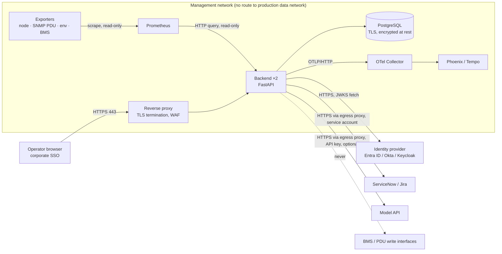

# Integration, security and monitoring architecture for production

<!-- Companion to production-rollout.md (when and in what order) and docs/architecture.md (what the system is). This document answers: how each external system is connected, how data is protected, what threats are checked, and what is watched once live. Decisions adopted here must be carried back into backend-spec §8–9 and the implementation plan. -->

## 1. When it goes live

Go-live is not one event. The rollout guide's phases each add one capability, and each has an exit criterion:

| Phase | Connected to | Allowed to | Exit criterion |
|---|---|---|---|
| P1 Replay | Recorded Prometheus data only | Nothing external | Known event → one zone incident; thresholds recorded |
| P2 Shadow | Live Prometheus, IdP | Read, create incidents in the DB; **no tickets, no pages** | 2 weeks, weekly sample reviewed, precision target met |
| P3 One zone | + ticketing (one assignment group) | Open/annotate/close tickets for one zone; runbooks notify-only | 4 weeks, ticket noise acceptable, approvals audited |
| P4 Full hall | + paging, task creation, optional model API | Page people, create tasks; AI triage behind budget | Monthly review; go-live checklist (README §12.6) ticked |
| P5 Steady state | Same | Same | Weekly trace sample, quarterly threshold review, six-monthly restore drill |

"Live" in the operational sense is the start of P3: the first time the system changes something another team sees (a ticket). Everything before is observation.

## 2. Integration architecture



### 2.1 Per-system connection design

| System | Direction | Protocol and port | Authentication | Data exchanged | Failure behaviour | Network rule |
|---|---|---|---|---|---|---|
| **Prometheus** | Backend → Prometheus | HTTP(S) 9090, `/api/v1/query` | None or basic auth/mTLS inside the management network | PromQL results for inlet, CPU, power, up, facility power, CRAC | Snapshot dropped and logged; console shows "feed lost"; alert if > 3 poll intervals | Allow backend → Prometheus only |
| **Exporters** | Prometheus → exporters | HTTP scrape | None (management network) | Metrics | Missing series = rack shows offline | Exporters are read-only; SNMP uses v3 with auth/priv, read community only |
| **Identity provider (OIDC)** | Browser → IdP (login); Backend → IdP (JWKS) | HTTPS 443 | OIDC auth-code with PKCE in the browser; backend validates RS256 JWT: issuer, audience, `exp`, `nbf` | ID/access token; claims `sub`, `name`, `roles` | Backend 401; JWKS cached 1 h so a short IdP outage does not block | Allow backend → IdP discovery and JWKS URLs only |
| **ServiceNow** | Backend → ServiceNow | HTTPS 443, Table API `/api/now/table/incident` | Dedicated service account (least privilege: create/update incident in one assignment group) or OAuth client credentials; secret from the secret manager | Short description, urgency/impact, description, work notes, state | 10 s timeout; failure recorded in the incident timeline; incident still saved; retry queue drains on the next event | Allow backend → `<instance>.service-now.com` via egress proxy |
| **Jira Cloud** | Backend → Jira | HTTPS 443, REST v3 `/rest/api/3/issue` | API token for a service user scoped to one project; secret from the secret manager | Summary, priority, ADF description, comments, transition | As ServiceNow | Allow backend → `<site>.atlassian.net` via egress proxy |
| **Model API** (optional) | Backend → provider | HTTPS 443 | API key from the secret manager; never in the browser | Sanitised operator text and current draft; structured draft back. **No telemetry, no incident ids, no names** | 503 to the operator; draft kept; no retry; budget settle | Allow only when the feature is approved; egress proxy with allow-list; disable by unsetting the key |
| **PostgreSQL** | Backend → DB | TLS 5432 (`sslmode=verify-full`) | DB role with least privilege (DML on app schema only; migrations by a separate role) | Incidents, events, runbook runs, AI spend | Backend `/healthz` reports `db: down`; writes fail closed (operator sees an error, nothing is lost silently) | Allow backend → DB only; no public endpoint |
| **Paging / tasks (P4)** | Backend → PagerDuty/Opsgenie/email | HTTPS 443 | Integration key from the secret manager | Runbook step notifications with incident id and step text | Step marked "notification failed"; operator sees it; no silent skip | Egress proxy allow-list |
| **BMS / PDU control** | — | — | — | — | — | **Denied.** No credentials exist in the system; firewall denies backend → BMS/PDU management ports |

### 2.2 Ticketing field mapping (both systems)
| Incident field | ServiceNow | Jira |
|---|---|---|
| `id` + `title` | `short_description` = `[INC-nnn] title` | `summary` |
| `sev` crit / warn | `urgency`,`impact` = 1 / 2 | `priority` Highest / High |
| `summary`, `rca`, `conf`, `runbook` | `description` | `description` (ADF) |
| timeline events | `work_notes` (one per event, with actor) | comment (one per event) |
| resolve | `state=6`, `close_code`, `close_notes` | transition to Done (`JIRA_DONE_TRANSITION`) |
| `ticket` back-reference | `sys_id` | issue key |
The ticket is the operator-facing record until T16 makes the database authoritative; after that it remains the audit mirror.

## 3. Database design for production

```
incidents        (id PK, kind, key, sev, title, summary, rca, conf, runbook,
                  opened_at timestamptz, closed_at, resolved bool, ticket_ref, created_by_sub_hash)
incident_events  (id PK, incident_id FK, at timestamptz, actor_sub_hash, actor_name, text)   -- append-only
runbook_runs     (id PK, incident_id FK, runbook, approved_by_sub_hash, approved_at, step, done bool)
ai_spend         (month PK, reserved_usd, settled_usd, calls)
schema_version   (Alembic)
```
- **Engine:** PostgreSQL 15/16; RDS Multi-AZ or an on-prem HA pair.
- **Encryption:** TLS in transit (`verify-full`), encryption at rest (KMS / LUKS).
- **Roles:** `aiops_app` (SELECT/INSERT/UPDATE on app tables; no DELETE on `incident_events`), `aiops_migrate` (DDL, used only by the migration task), `aiops_readonly` (reporting).
- **Backups:** automated daily with PITR (7–35 days); manual snapshot before any destructive change (`backup.sh`); restore drill every six months (`restore.sh INC-nnn` must print PASS).
- **Retention:** incidents and events kept ≥ 13 months (one audit cycle); `ai_spend` indefinitely (small).
- **PII:** operator identity stored as a SHA-256 hash of `sub` plus the display name from the token; no email addresses; no free-text operator notes stored beyond what the operator typed into the incident.

## 4. Security architecture

### 4.1 Trust boundaries and threat model (STRIDE, abbreviated)

| Threat | Where | Control |
|---|---|---|
| **Spoofing** an operator | Browser → backend | OIDC with PKCE; RS256 JWT validated against the IdP JWKS (issuer, audience, expiry); no local accounts; `AUTH_MODE=dev` refused when `ENV=production` |
| **Tampering** with telemetry | Exporters → Prometheus → backend | Management-network isolation; SNMPv3 auth/priv; snapshot schema validation (malformed snapshots dropped); detection thresholds are code, not input |
| **Tampering** with the write path via the model | Model → backend | The model returns a proposal only; the AI module has no import path to the incident router (test AI-6); post-validation in code; the operator's confirm sends exact fields |
| **Prompt injection** in operator or pasted text | Operator → model | Text placed in the user turn, delimited and declared as data; rules in the system prompt; golden case T8; post-validation rejects out-of-schema output (503, never a partial draft) |
| **Repudiation** | Approvals, resolutions | Every event stored append-only with actor hash and name, mirrored as ticket work notes; traces carry `request_id` |
| **Information disclosure** | Traces, logs, model calls | API key and bearer redacted in spans; emails/phones masked; identity hashed; model receives sanitised text only; TLS everywhere; secrets only in the secret manager |
| **Denial of service** | Model endpoint, API | Per-user rate limit (replica-wide via Redis in production), monthly budget reserve/settle, 2,000-char input cap, WAF rate rules at the proxy |
| **Elevation of privilege** | Approve runbook; actuation | RBAC: `dc-shift-lead` required to approve; no actuation endpoint exists; firewall denies backend → BMS/PDU |
| **Supply chain** | Dependencies, images, IaC | Pinned versions; dependency and image scanning in CI; signed images; Terraform scanned; GitHub OIDC for deploy (no long-lived cloud keys) |

### 4.2 Controls by layer

| Layer | Controls |
|---|---|
| Network | Management VLAN; deny-by-default firewall; explicit allow rules per row of §2.1; egress proxy with allow-list for ticketing and the model provider; no inbound from the internet to the backend (operators reach it through the corporate network or VPN); CloudFront/WAF only if the AWS profile is used |
| Transport | TLS 1.2+ everywhere; HSTS at the proxy; `verify-full` to PostgreSQL; certificates from the corporate CA |
| Identity | OIDC SSO; MFA enforced at the IdP; roles `dc-operator`, `dc-shift-lead`, `dc-readonly` mapped from IdP groups; token lifetime set by the IdP (short access tokens, refresh in the browser) |
| Application | Pydantic validation on every input; enums enforced (422); 2,000-char caps; CORS restricted to the console origin; security headers (CSP allowing only cdnjs and Google Fonts, `X-Frame-Options: DENY`); no actuation endpoint; AI module isolated |
| Data | Encryption at rest; least-privilege DB roles; append-only events; hashed identity; backups encrypted; retention policy |
| Secrets | AWS Secrets Manager / HashiCorp Vault / Kubernetes Secrets; injected as env at start; rotated: DB password 90 days, ticketing token 90 days, model key 90 days; `.env` never committed (`.gitignore`) |
| Container | Non-root user; read-only root filesystem; dropped capabilities; pinned base image `python:3.12-slim` rebuilt monthly; image scanned and signed |
| CI/CD | GitHub OIDC role trust limited to repo and branch; branch protection on `main`; required checks (ruff, pytest, evals --mock, scans); deploy only from tagged commits; manual trigger for recovery |
| Model usage | Key server-side only; bounded calls (20 s, 1,024 tokens, no retries); budget; sanitised input; output validated; feature can be disabled by configuration; provider data-handling terms reviewed by security |

### 4.3 Security and cyber-threat checks

| Check | Tool (examples) | When | Gate |
|---|---|---|---|
| Static analysis (SAST) | Bandit, Semgrep, ruff security rules, CodeQL | Every push | Block on high |
| Dependency vulnerabilities | pip-audit, Dependabot / Renovate, OSV-Scanner | Every push + weekly | Block on critical; ticket on high |
| Secret scanning | gitleaks, GitHub secret scanning | Every push | Block |
| Container image scan | Trivy or Grype | On build | Block on critical |
| IaC scan | tfsec / Checkov, `terraform validate` | On change to `deploy/terraform` | Block on high |
| SBOM and image signing | Syft + Cosign | On build | Required for deploy |
| Dynamic scan (DAST) | OWASP ZAP baseline against staging | Pre-release | Review findings |
| Prompt-injection and AI misuse tests | Golden case T8 family; `pytest -k injection`; red-team prompts added to the eval set | Every push (mocked) + pre-release (live) | Block on regression |
| Authorization tests | pytest per role (operator cannot approve; read-only cannot write) | Every push | Block |
| Penetration test | External, scoped to console, API, egress and the ticketing integration | Before P4 and annually | Findings closed or accepted by the owner |
| Configuration review | Firewall rules, IdP app settings, secret-manager policies | Before P3 and on change | Signed |
| Backup/restore drill | `backup.sh`, `restore.sh` | Before P4, then every six months | PASS |

## 5. Monitoring in production ("monitoring the monitor")

| Concern | Signal | Tool | Alert when |
|---|---|---|---|
| Backend liveness | `GET /healthz` → `ok`, `db`, `adapter`, `tracing` | Blackbox exporter + Alertmanager; or the site's uptime tool | Non-200 for 1 min |
| Feed freshness | Age of the last snapshot; racks reporting per zone | Backend metric `aiops_snapshot_age_seconds`, `aiops_racks_reporting{zone}` | Age > 3 × `POLL_SECONDS`; racks < expected |
| Detection health | Incidents opened/resolved per hour; incidents open > 2 h | Backend metrics | Spike or silence vs baseline |
| Ticket sync | Failures per hour, latency | Backend metric + timeline entries | Any failure in 15 min |
| Database | Connections, replication lag, disk, backup age | RDS/CloudWatch or node/postgres exporters | Backup age > 26 h; lag > 60 s |
| AI triage | Calls, 429/503 rate, latency p95, tokens, month-to-date spend | OTel traces → Phoenix (quality) and Tempo/Jaeger (ops); budget metric | 503 rate > 5 %; spend > 80 % of budget |
| AI quality drift | Weekly sample of traces labelled by the owner; golden-set live run | Phoenix annotations; `run_cases.py --live` | Any new failure category; golden regression |
| Logs | Structured JSON logs with `request_id`, no secrets | Loki + Grafana, or ELK | Error rate; auth failures |
| Security events | Auth failures, 401/403 spikes, WAF blocks, egress denials, admin actions | SIEM (Wazuh, Splunk, Sentinel); IdP sign-in logs; proxy logs | Brute force; unexpected egress; privilege change |
| Infrastructure drift | `terraform plan` in CI | Scheduled nightly | Any diff |
| Cost | Cloud bill, model spend | Cloud cost explorer; `ai_spend` | > budget forecast |
| Certificates and secrets | Expiry dates | Secret-manager rotation alerts; cert monitor | < 14 days to expiry |

Dashboards: one Grafana board per concern above, plus the console's own KPIs. The console must never be the only place an outage is visible; if the console is down, Alertmanager pages the owner through the site's existing channel.

## 6. Incident response for the system itself

| Event | Action | Owner |
|---|---|---|
| Backend down | Restore from the last good image via the manual deploy trigger; operators fall back to Prometheus/Grafana and the ticketing queue | Platform on-call |
| Suspected compromise of a credential | Revoke in the secret manager; rotate; review SIEM for use; disable ticket sync and AI triage until cleared | Security |
| Ticketing outage | Incidents keep saving; timeline shows "ticket sync failed"; sync resumes automatically | None required |
| Model provider outage or budget exhausted | Triage shows manual entry; nothing else affected | None required |
| False incident storm (threshold wrong) | `TICKETING=none` (stops the noise reaching other teams); review thresholds on replay data; redeploy | Owner |
| Data loss | Restore from PITR or snapshot per `restore.sh`; verify a known incident | Platform on-call |

## 7. Compliance mapping (for the site's auditors)

| Requirement area | Where it is met |
|---|---|
| Access control, MFA, least privilege | §4.2 Identity, DB roles, service accounts |
| Audit trail | Append-only `incident_events` with actor; ticket work notes; traces with `request_id` |
| Change management | Phased rollout with exit criteria; branch protection; tagged releases; `terraform plan` review |
| Data protection and retention | §3 encryption, hashing, retention; model receives sanitised text only |
| Vulnerability management | §4.3 schedule and gates |
| Backup and recovery | §3 backups; six-monthly drill with PASS evidence |
| Third-party risk | §2.1 per-system auth, scope and failure behaviour; provider terms reviewed before enabling AI triage |

## 8. What this document does not claim
None of these controls has been exercised against a production hall yet. Each row above names the evidence that will show it is in place; the go-live checklist (README §12.6) is where those evidences are collected.
