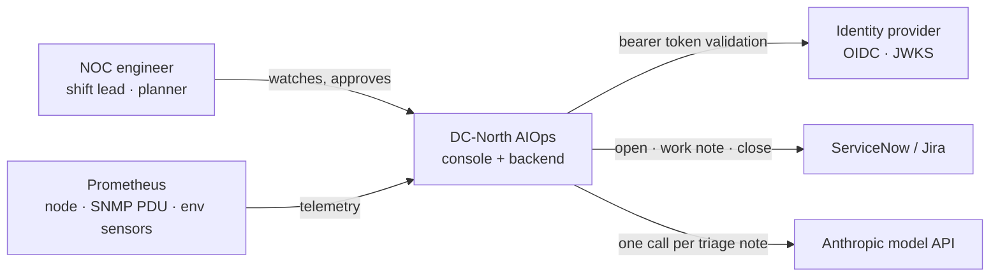
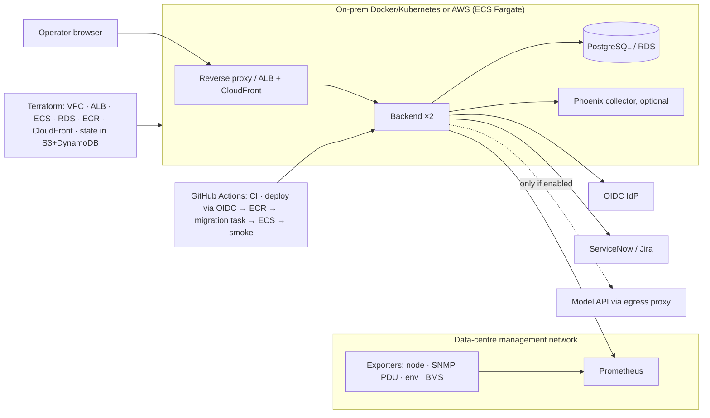

# Architecture — DC-North AIOps

<!-- Weekend 6: C4 (context → containers → components), one complete request, boundaries and failure, authority, where authoritative information lives. HTML version with the same content: dc-aiops-architecture.html (GitHub Pages). -->

## 1. Context (who uses it, what it depends on)



The model API is the only dependency that is not ordinary IT-operations tooling, and it is optional (unset the key and the Triage tab offers manual entry only).

## 2. Containers

| Container | Responsibility | Owns |
|---|---|---|
| **Console** (browser, `frontend/index.html`) | Draws the floor; runs the z-score detector and the zone correlator; holds the runbook catalogue; drafts triage requests; tracks confirmation state. | Detection logic, the Approve button |
| **Backend** (FastAPI, `backend/`) | Polls an adapter every 2 s and broadcasts snapshots; validates tokens; persists incidents and timeline events; syncs tickets; serves `/ai/triage`. | Authority: every write and every model call |
| **Database** (PostgreSQL; in-memory in the POC) | Incidents, timeline events, runbook runs, month-to-date AI spend. Telemetry history stays in Prometheus. | The incident record (with the ticket) |
| **Phoenix** (local, optional) | One OpenTelemetry trace per triage call for evaluation. | Evaluation evidence |

A C4 container is a runnable unit, not necessarily a Docker container.

## 3. Components inside the backend

| Component | Does |
|---|---|
| `adapters/simulator.py`, `adapters/prometheus.py` | Return one `Snapshot` shape; PromQL overridable per site (`PROM_Q_*`) |
| `poll_loop` | Fetch, validate, broadcast over WebSocket, keep `latest` for new clients |
| `auth.py` | OIDC discovery → JWKS (cached 1 h); `dev` bypass refused when `ENV=production` |
| incidents router | `POST /incidents` 201/409/422 · `/log` · `/resolve` 409-if-resolved · `GET` |
| `integrations/servicenow.py`, `integrations/jira.py` | Open, work note, close; 10 s timeout; failure logged to the timeline, never blocks the operator |
| `ai/triage.py` | One `AsyncAnthropic` call with a declared response model; rules table v1 in the system prompt; post-validation and rack-id normalisation; **imports nothing that writes** |
| `ai/budget.py`, `ai/ratelimit.py` | Reserve/settle against the monthly budget; 10 req/min/user token bucket |
| `ai/tracing.py` | Five named spans per triage call; key and bearer redacted; no-op when no collector |

## 4. One complete request: telemetry → approved runbook

```mermaid
sequenceDiagram
  participant A as Adapter
  participant B as Backend
  participant C as Console
  participant D as DB + ticket
  A->>B: snapshot (24 racks)
  B->>C: WebSocket push
  C->>C: z-score per metric; ceilings 27 °C / 92 %
  C->>C: ≥ 3 hot racks in a zone → one CRAC incident
  C->>B: POST /api/v1/incidents
  B->>D: insert; open ticket
  Note over C: operator taps Approve
  C->>B: POST /incidents/{id}/log "approved runbook …" (actor from token)
  C->>C: steps page people and tools; nothing actuated
  C->>B: POST /incidents/{id}/resolve after 5 normal samples
  B->>D: resolved; ticket closed
```

## 5. One complete request: free-text triage → saved incident

```mermaid
sequenceDiagram
  participant C as Console
  participant B as Backend
  participant M as Model API
  participant D as DB + ticket
  C->>B: 1 POST /api/v1/ai/triage {text, draft, history}
  B->>B: rate limit · budget reserve · trace
  B->>M: 2 rules + note (as data) · 20 s · 1,024 tokens · no retry
  M-->>B: 3 structured draft
  B->>B: validate · normalise ids · budget settle
  B-->>C: 4 draft, missing_fields, clarification_fields, reply
  Note over C: 5 operator edits and confirms (no model call)
  C->>B: 6 POST /api/v1/incidents (exact reviewed fields, X-Draft-Request-Id)
  B->>D: 7 insert; open ticket
  B-->>C: 8 201 Incident
```

Steps 1–4 never write. Step 6 is the only write. The model is not called at step 6. *A suggestion is not permission to change the itinerary* — here, to change the incident list.

## 6. Boundaries and failure: testable requirements

| Situation | Required behaviour | Enforced by | Test that exposes a failure |
|---|---|---|---|
| Telemetry feed unavailable | Toast "Feed lost"; console keeps working on the simulator; reconnect every 5 s | Console `connectFeed` | AC-7 manual: stop backend |
| Model times out / unusable output | 503; draft preserved; manual entry; no retry | `ai/triage` post-validation | `pytest -k bounds` |
| Older triage reply arrives after an operator edit | Operator's value kept | Console `tr.seq` / `tr.touched` | Manual: edit Key mid-request |
| Operator confirms a draft | Exact reviewed fields; written once; id unique | Incidents router 409 | `pytest tests/test_api.py -k duplicate` |
| Operator text contains instructions | Treated as data | Prompt framing + validation | Golden case T8; `pytest -k injection` |
| Monthly AI budget exhausted | 429 with reason; manual path still works | `ai/budget` | `pytest -k budget` |
| Ticketing down | Incident still saves; failure in timeline | Router try/except, 10 s timeout | Integration test with failing stub |
| Someone adds a write path from the AI module | Build fails | Import-boundary test AI-6 | Mutation: add the import → red (done, see docs/test-the-test.md) |
| Save response lost | "The incident may already exist — check Incidents"; never auto-replay | Console `trConfirm` catch | Manual: kill backend after request |

## 7. Authority

| Action | Who | Enforced where |
|---|---|---|
| Read telemetry | Anyone with the console (read-only socket) | Backend |
| Open, note, resolve an incident | Authenticated operator | Backend bearer check |
| Approve a runbook | Authenticated operator (role check `dc-shift-lead` planned for production) | Console button → logged event with actor |
| Call the model | Authenticated operator, within rate and budget | Backend limiter + budget |
| Write an incident from a model reply | Nobody; the reply has no write path | Import boundary; confirm step |
| Actuate cooling or power | Nobody; runbooks page people and tools | No such endpoint exists |

## 8. Where authoritative information lives

| Information | Source of truth | Copies |
|---|---|---|
| Rack telemetry and history | Prometheus | Console keeps the last 20 samples per rack |
| Incidents and timeline | Database (ticket until Phase 7 proves DB restore) | Console memory for the session |
| Runbook catalogue | Console source (v1); backend table planned | — |
| Triage interpretation rules | `AI-spec.md` §4, `rules_version` | System prompt carries the same table |
| Who approved what | Timeline events with actor from the token | Ticket work notes |

## 9. Deployment view



Restore proof (Phase 7): after `backup.sh` → `destroy.sh` → `restore.sh INC-nnn`, `GET /api/v1/incidents` returns the same incident with its original `opened` timestamp. Blocked until incidents are persisted (T16).

## 10. Decisions

Why each of the above is the way it is: `docs/design-decisions.md` (12 ADRs with context, alternatives, consequences and revisit-when conditions).
